

  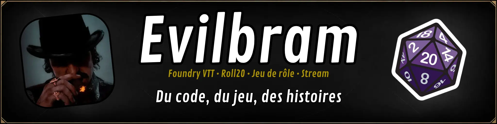

Je conçois des **outils, modules et systèmes pour le jeu de rôle**, principalement sur **Foundry VTT** et **Roll20**, avec une attention particulière portée à l’ergonomie et au rendu visuel. L’objectif reste toujours le même : **réduire les manipulations inutiles pour laisser davantage de place aux joueurs, à l’ambiance et à la narration**.

> I create **tools, modules and game systems for tabletop RPGs**, mainly for **Foundry VTT** and **Roll20**, with a strong focus on usability and visual design. The goal is always the same: **reduce unnecessary friction and leave more room for the players, atmosphere and storytelling**.

  

  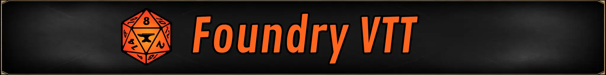

C'est ici que se concentre l'essentiel de mes projets de développement pour **Foundry VTT** : systèmes, modules et outils conçus pour fluidifier la partie sans sacrifier l'interface ni l'immersion.

## 📜 Systèmes de jeu

<table>
<tr>
<td width="50%" align="center">
<a href="https://foundryvtt.com/packages/tencandles-ga">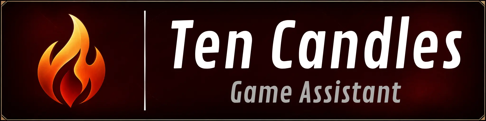</a> 
Un système complet pour jouer à Ten Candles sans laisser la technique prendre le pas sur la narration · <a href="https://github.com/ctotone/tencandles-ga">GitHub</a>
</td>

<td width="50%" align="center">
 
Un système homebrew D100 générique, léger et orienté narration pour Foundry VTT v14 · <a href="https://github.com/ctotone/interface-ga">GitHub</a>
</td>
</tr>

<tr>
<td colspan="2" align="center">
 
Un système de jeu complet en bêta : personnages, compétences, combat, magie, progression et activités longues · <a href="https://github.com/ctotone/BETA-TEST-Arkhanval">Bêta / GitHub</a>
</td>
</tr>
</table>

## 🧩 Modules

<table>
<tr>
<td width="50%" align="center">
<a href="https://foundryvtt.com/packages/evil-coc7-card">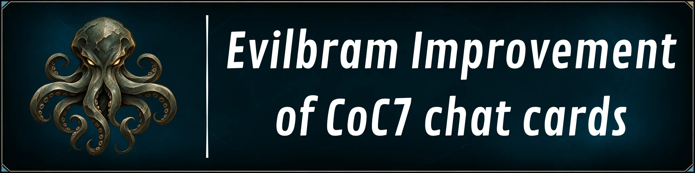</a> 
Des cartes de chat CoC7 plus lisibles, compactes et agréables, sans modifier la logique du système · <a href="https://github.com/ctotone/evil-coc7-card">GitHub</a>
</td>

<td width="50%" align="center">
<a href="https://foundryvtt.com/packages/evil-deltagreen-card">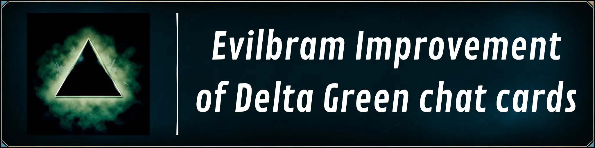</a> 
Un nouvel habillage des cartes de chat Delta Green, plus lisible et immersif, sans toucher aux règles · <a href="https://github.com/ctotone/evil-deltagreen-card">GitHub</a>
</td>
</tr>

<tr>
<td width="50%" align="center">
<a href="https://foundryvtt.com/packages/evil-light-toolkit">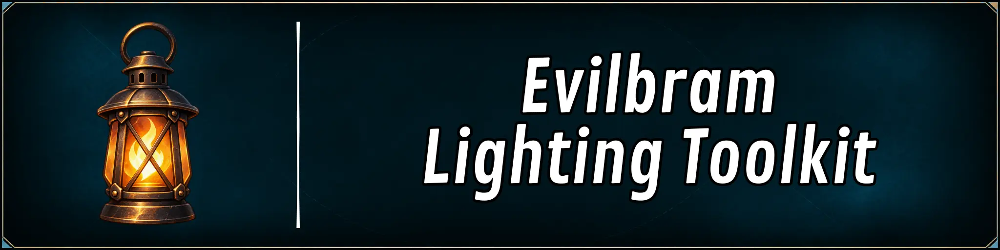</a> 
Préparer rapidement l'éclairage et l'ambiance des scènes grâce à des presets et outils dédiés · <a href="https://github.com/ctotone/evil-light-toolkit">GitHub</a>
</td>

<td width="50%" align="center">
 
Une véritable messagerie privée intégrée à Foundry pour échanger discrètement sans interrompre la partie · <a href="https://github.com/ctotone/evil-messenger">GitHub</a>
</td>
</tr>

<tr>
<td width="50%" align="center">
 
Pools de dés, résolution des conflits et progression des dix bougies pour accompagner les parties de Ten Candles · <a href="https://github.com/ctotone/evil-tencandles-roll">GitHub</a>
</td>

<td width="50%" align="center">
 
Copier rapidement l'UUID des éléments Foundry directement depuis leur menu contextuel · <a href="https://github.com/ctotone/uuid-copier">GitHub</a>
</td>
</tr>
</table>

## 🤝 Contribution

<table>
<tr>
<td align="center">
 
Participation à la traduction française non officielle de Deadlands pour Savage Worlds Adventure Edition · <a href="https://www.uberwald.me/gitea/public/swade-fr-content/">dépôt</a>
</td>
</tr>
</table>

<a href="https://foundryvtt.com/community/evilbram/packages"><strong>→ Retrouver mes créations publiées sur le catalogue Foundry VTT</strong></a>

  

  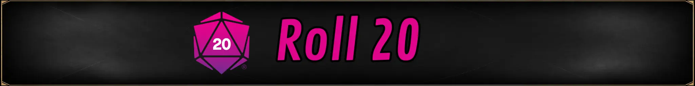

Je crée également des **fiches de personnage et interfaces personnalisées pour Roll20**, pensées pour rester fidèles à l'identité visuelle de chaque jeu tout en rendant leur utilisation aussi fluide que possible.

<table>
<tr>
<td width="50%" align="center">
<a href="https://github.com/Roll20/roll20-character-sheets/tree/master/Cabinet%20des%20Murmures">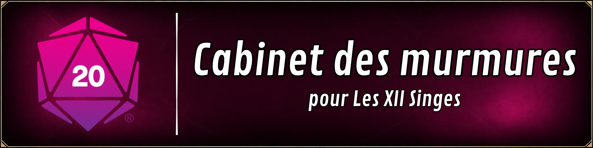</a> 
Création Roll20 pour Cabinet des Murmures · <a href="https://github.com/Roll20/roll20-character-sheets/tree/master/Cabinet%20des%20Murmures">dépôt Roll20</a>
</td>

<td width="50%" align="center">
<a href="https://github.com/Roll20/roll20-character-sheets/tree/master/Dedales">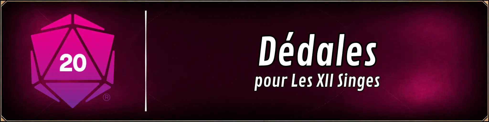</a> 
Création Roll20 pour Dédales · <a href="https://github.com/Roll20/roll20-character-sheets/tree/master/Dedales">dépôt Roll20</a>
</td>
</tr>

<tr>
<td width="50%" align="center">
<a href="https://github.com/Roll20/roll20-character-sheets/tree/master/Dirty%20System">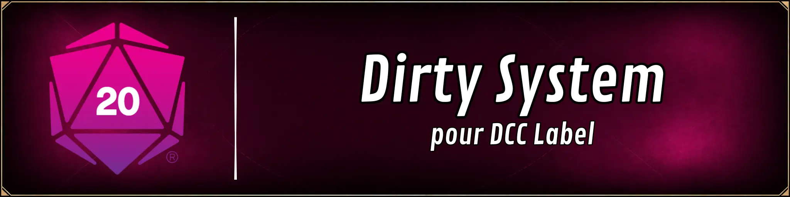</a> 
Création Roll20 pour Dirty · <a href="https://github.com/Roll20/roll20-character-sheets/tree/master/Dirty%20System">dépôt Roll20</a>
</td>

<td width="50%" align="center">
<a href="https://github.com/Roll20/roll20-character-sheets/tree/master/Into%20the%20Odd%202nd%20edition">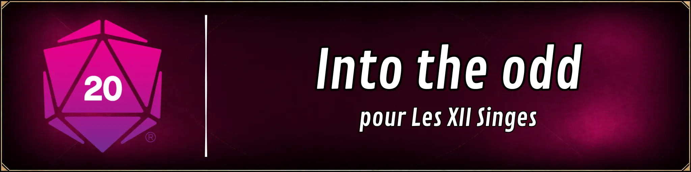</a> 
Création Roll20 pour Into the Odd · <a href="https://github.com/Roll20/roll20-character-sheets/tree/master/Into%20the%20Odd%202nd%20edition">dépôt Roll20</a>
</td>
</tr>

<tr>
<td width="50%" align="center">
<a href="https://github.com/Roll20/roll20-character-sheets/tree/master/Notre%20tombeau">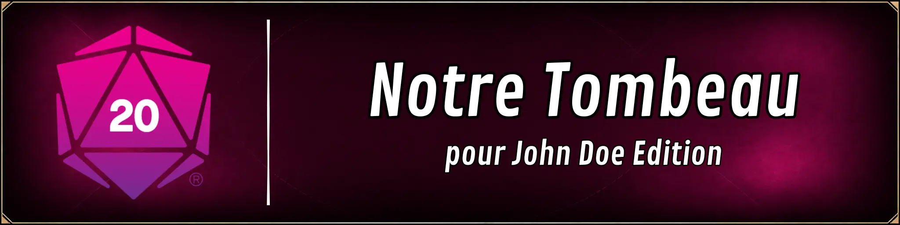</a> 
Création Roll20 pour Notre Tombeau · <a href="https://github.com/Roll20/roll20-character-sheets/tree/master/Notre%20tombeau">dépôt Roll20</a>
</td>

<td width="50%" align="center">
<a href="https://github.com/Roll20/roll20-character-sheets/tree/master/Patient13%20v1.5">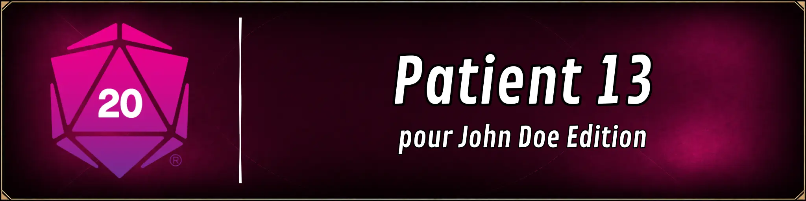</a> 
Création Roll20 pour Patient 13 · <a href="https://github.com/Roll20/roll20-character-sheets/tree/master/Patient13%20v1.5">dépôt Roll20</a>
</td>
</tr>

<tr>
<td width="50%" align="center">
<a href="https://github.com/Roll20/roll20-character-sheets/tree/master/Ten%20candles">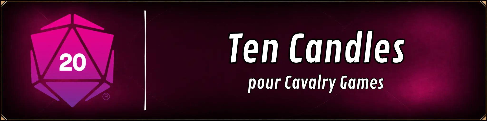</a> 
Création Roll20 pour Ten Candles · <a href="https://github.com/Roll20/roll20-character-sheets/tree/master/Ten%20candles">dépôt Roll20</a>
</td>

<td width="50%" align="center">
<a href="https://github.com/Roll20/roll20-character-sheets/tree/master/Thanatos">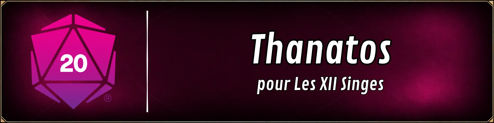</a> 
Création Roll20 pour Thanatos · <a href="https://github.com/Roll20/roll20-character-sheets/tree/master/Thanatos">dépôt Roll20</a>
</td>
</tr>

<tr>
<td width="50%" align="center">
<a href="https://github.com/Roll20/roll20-character-sheets/tree/master/Chroniques_Katura">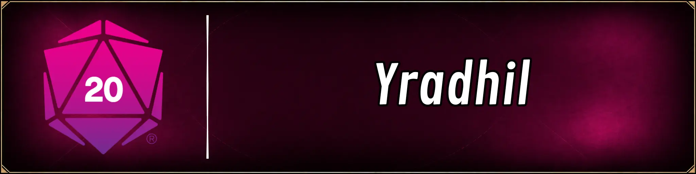</a> 
Création Roll20 pour Yradhil · <a href="https://github.com/Roll20/roll20-character-sheets/tree/master/Chroniques_Katura">dépôt Roll20</a>
</td>

<td width="50%" align="center">
<a href="https://github.com/Roll20/roll20-character-sheets/tree/master/Obscuritas">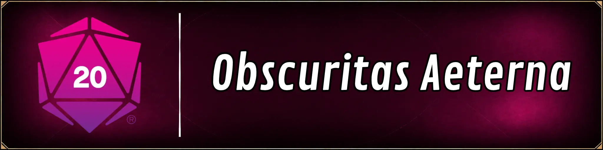</a> 
Feuille de personnage Roll20 pour Obscuritas Æterna · <a href="https://github.com/Roll20/roll20-character-sheets/tree/master/Obscuritas">dépôt Roll20</a>
</td>
</tr>
</table>

  

  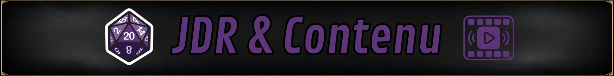

Développer des outils n'est qu'une facette de ma passion pour le jeu de rôle : j'aime avant tout **faire jouer, créer des ambiances et raconter des histoires autour d'une table**.

Je partage une partie de ces aventures en live et en vidéo, et le Discord sert de point de rencontre autour des parties, des projets et du JdR en général.

<table>
<tr>
<td width="50%" align="center">
<a href="https://www.twitch.tv/evilbram">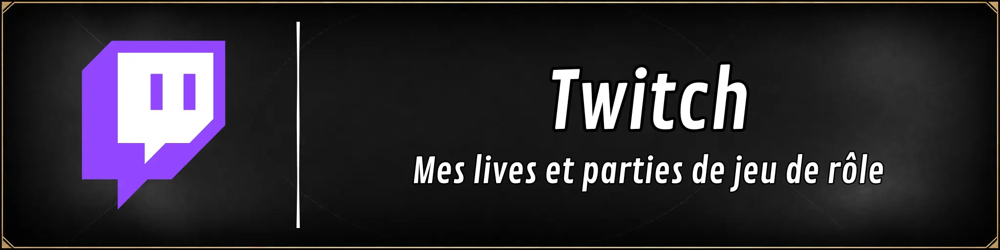</a> 
Lives et parties de jeu de rôle · <a href="https://www.twitch.tv/evilbram">Twitch</a>
</td>

<td width="50%" align="center">
<a href="https://www.youtube.com/@Evilbram">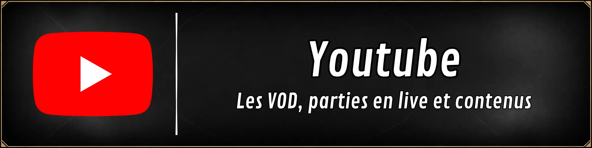</a> 
VOD, parties et vidéos autour du jeu de rôle · <a href="https://www.youtube.com/@Evilbram">YouTube</a>
</td>
</tr>

<tr>
<td colspan="2" align="center">
<a href="https://discord.gg/UAFqYhaSap">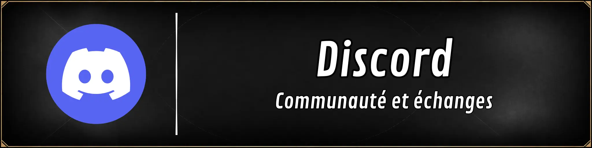</a> 
Communauté, parties, projets et échanges autour du JdR · <a href="https://discord.gg/UAFqYhaSap">Discord</a>
</td>
</tr>
</table>
