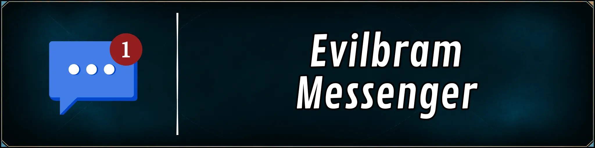
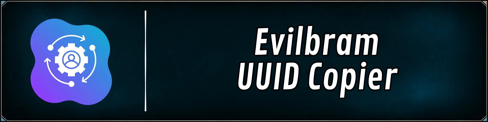
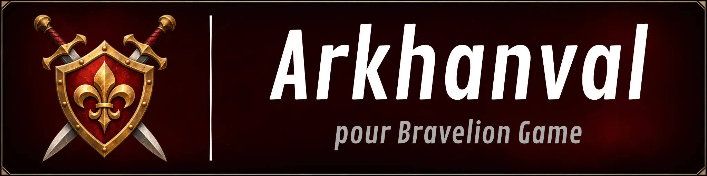
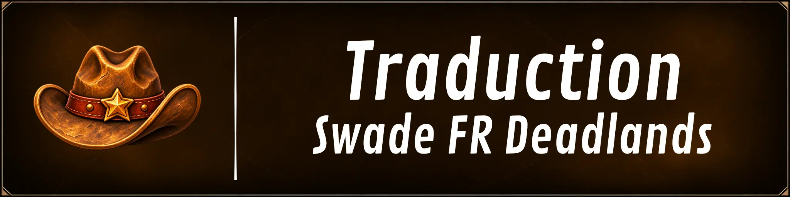

# EVILBRAM

**Foundry VTT • Roll20 • Jeu de rôle • Stream**

Je développe des outils, modules et systèmes autour du **jeu de rôle**, avec une place centrale accordée à **Foundry VTT**, mais aussi des créations pour **Roll20**.

Je partage également ma passion du JdR à travers mes parties, streams et vidéos.

Mon fil rouge reste toujours le même : **soigner l'expérience de jeu autant que l'expérience visuelle**.

Une fiche, un système ou un module doit être agréable à regarder, mais surtout faciliter la partie, réduire les manipulations inutiles et laisser le maximum de place à ce qui compte vraiment : **les joueurs, l'ambiance et la narration**.

---

## 🎲 Foundry VTT
C'est ici que se concentre l'essentiel de mes projets de développement : modules, outils et systèmes de jeu pensés pour améliorer l'expérience de jeu sur Foundry Virtual Tabletop.

Mon objectif reste le même : réduire les manipulations inutiles, soigner l'interface et laisser davantage de place aux joueurs, à l'ambiance et à la narration.

## 🧩 Modules
<table>
<tr>
<td width="50%" align="center">
 
Des cartes de chat CoC7 plus lisibles, compactes et agréables, sans modifier la logique du système · <a href="https://github.com/ctotone/evil-coc7-card">GitHub</a>
</td>
<td width="50%" align="center">
 
Un nouvel habillage des cartes de chat Delta Green, plus lisible et immersif, sans toucher aux règles · <a href="https://github.com/ctotone/evil-deltagreen-card">GitHub</a>
</td>
</tr><tr>
<td width="50%" align="center">
 
Préparer rapidement l'éclairage et l'ambiance des scènes grâce à des presets et outils dédiés · <a href="https://github.com/ctotone/evil-light-toolkit">GitHub</a>
</td>
<td width="50%" align="center">
 
Une véritable messagerie privée intégrée à Foundry pour échanger discrètement sans interrompre la partie · <a href="https://github.com/ctotone/evil-messenger">GitHub</a>
</td>
</tr><tr>
<td width="50%" align="center">
 
Pools de dés, résolution des conflits et progression des dix bougies pour accompagner les parties de Ten Candles · <a href="https://github.com/ctotone/evil-tencandles-roll">GitHub</a>
</td>
<td width="50%" align="center">
 
Copier rapidement l'UUID des éléments Foundry directement depuis leur menu contextuel · <a href="https://github.com/ctotone/uuid-copier">GitHub</a>
</td>
</tr>
</table>

## 📜 Systèmes de jeu
<table>
<tr>
<td width="50%" align="center">
 
Un système complet pour jouer à Ten Candles sans laisser la technique prendre le pas sur la narration · <a href="https://github.com/ctotone/tencandles-ga">GitHub</a>
</td>
<td width="50%" align="center">
 
Un système D100 générique, léger et orienté narration pour Foundry VTT v14 · <a href="https://github.com/ctotone/interface-ga">GitHub</a>
</td>
</tr><tr>
<td width="50%" align="center">
 
Un système de jeu complet en bêta : personnages, compétences, combat, magie, progression et activités longues · <a href="https://github.com/ctotone/BETA-TEST-Arkhanval">Bêta / GitHub</a>
</td>
<td width="50%"></td>
</tr>
</table>

## 🤝 Contribution
<table>
<tr>
<td width="50%" align="center">
 
Participation à la traduction française non officielle de Deadlands pour Savage Worlds Adventure Edition · <a href="https://www.uberwald.me/gitea/public/swade-fr-content/">dépôt</a>
</td>
<td width="50%"></td>
</tr>
</table>

<a href="https://foundryvtt.com/community/evilbram/packages"><strong>→ Retrouver mes créations publiées sur le catalogue Foundry VTT</strong></a>

---

# 🐉 Autour du jeu de rôle

Foundry représente aujourd'hui la plus grosse partie de mes projets de développement, mais Evilbram ne s'arrête pas là.

## 🎨 Roll20

Avant Foundry — et encore aujourd'hui pour certains projets — je crée également des **fiches de personnage, interfaces et adaptations personnalisées pour Roll20**.

L'objectif reste le même : proposer des fiches agréables à utiliser, visuellement cohérentes avec le jeu qu'elles accompagnent, et limiter autant que possible les manipulations qui coupent le rythme de la partie.

<table>
<tr>
<td width="33%" align="center"><a href="https://github.com/ctotone/JdR/tree/main/%23Roll20%20valid%C3%A9e/Cabinet%20des%20murmures"><strong>Cabinet des murmures</strong></a></td>
<td width="33%" align="center"><a href="https://github.com/ctotone/JdR/tree/main/%23Roll20%20valid%C3%A9e/Dedales"><strong>Dédales</strong></a></td>
<td width="33%" align="center"><a href="https://github.com/ctotone/JdR/tree/main/%23Roll20%20valid%C3%A9e/Dirty"><strong>Dirty</strong></a></td>
</tr>
<tr>
<td width="33%" align="center"><a href="https://github.com/ctotone/JdR/tree/main/%23Roll20%20valid%C3%A9e/Into%20the%20Odd"><strong>Into the Odd</strong></a></td>
<td width="33%" align="center"><a href="https://github.com/ctotone/JdR/tree/main/%23Roll20%20valid%C3%A9e/Notre%20tombeau"><strong>Notre Tombeau</strong></a></td>
<td width="33%" align="center"><a href="https://github.com/ctotone/JdR/tree/main/%23Roll20%20valid%C3%A9e/Patient13"><strong>Patient 13</strong></a></td>
</tr>
<tr>
<td width="33%" align="center"><a href="https://github.com/ctotone/JdR/tree/main/%23Roll20%20valid%C3%A9e/Ten%20candles"><strong>Ten Candles</strong></a></td>
<td width="33%" align="center"><a href="https://github.com/ctotone/JdR/tree/main/%23Roll20%20valid%C3%A9e/Thanatos"><strong>Thanatos</strong></a></td>
<td width="33%" align="center"><a href="https://github.com/ctotone/JdR/tree/main/%23Roll20%20valid%C3%A9e/Yradhil"><strong>Yradhil</strong></a></td>
</tr>
</table>

<a href="https://github.com/ctotone/JdR/tree/main/%23Roll20%20valid%C3%A9e"><strong>→ Voir mes créations Roll20</strong></a>

## 🎥 JdR & contenu

Développer des outils n'est qu'une facette de ma passion pour le jeu de rôle : j'aime avant tout **faire jouer, créer des ambiances et raconter des histoires autour d'une table**.

Je partage une partie de ces aventures en live et en vidéo, et le Discord sert de point de rencontre autour des parties, des projets et du JdR en général.

<table>
<tr>
<td width="33%" align="center">
<strong>🎥 Twitch</strong> 
Lives et parties de jeu de rôle 
<a href="https://www.twitch.tv/evilbram">twitch.tv/evilbram</a>
</td>
<td width="33%" align="center">
<strong>▶️ YouTube</strong> 
VOD, parties et contenus 
<a href="https://www.youtube.com/@Evilbram">@Evilbram</a>
</td>
<td width="33%" align="center">
<strong>💬 Discord</strong> 
Communauté et échanges 
<a href="https://discord.gg/UAFqYhaSap">Rejoindre le serveur</a>
</td>
</tr>
</table>

<!--
À compléter plus tard si souhaité :
### Quelques univers que j'aime faire jouer
Une sélection légère de jeux / univers, sans transformer cette page en catalogue de campagnes.
-->

---

# 🔗 Me retrouver

<table>
<tr>
<td width="50%" align="center">
<strong>🎲 Foundry VTT</strong> 
<a href="https://foundryvtt.com/community/evilbram/packages">Catalogue de mes créations</a>
</td>
<td width="50%" align="center">
<strong>💻 GitHub</strong> 
<a href="https://github.com/ctotone">github.com/ctotone</a>
</td>
</tr>
<tr>
<td width="50%" align="center">
<strong>🎨 Roll20</strong> 
<a href="https://github.com/ctotone/JdR/tree/main/%23Roll20%20valid%C3%A9e">Fiches et créations</a>
</td>
<td width="50%" align="center">
<strong>🎥 Twitch</strong> 
<a href="https://www.twitch.tv/evilbram">twitch.tv/evilbram</a>
</td>
</tr>
<tr>
<td width="50%" align="center">
<strong>▶️ YouTube</strong> 
<a href="https://www.youtube.com/@Evilbram">@Evilbram</a>
</td>
<td width="50%" align="center">
<strong>💬 Discord</strong> 
<a href="https://discord.gg/UAFqYhaSap">Rejoindre la communauté</a>
</td>
</tr>
</table>
