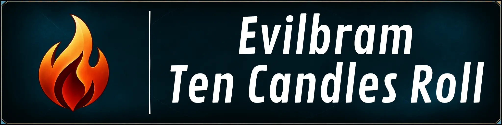
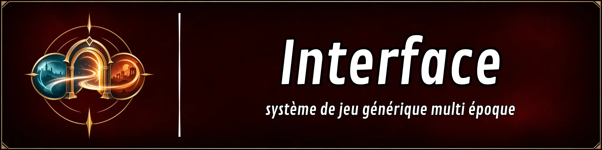

🎲 Foundry VTT
C'est ici que se concentre l'essentiel de mes projets de développement : modules, outils et systèmes de jeu pensés pour améliorer l'expérience de jeu sur Foundry Virtual Tabletop.

Mon objectif reste le même : réduire les manipulations inutiles, soigner l'interface et laisser davantage de place aux joueurs, à l'ambiance et à la narration.

## 🧩 Modules
<table>
<tr>
<td width="50%" align="center">
 
Des cartes de chat CoC7 plus lisibles, compactes et agréables, sans modifier la logique du système · <a href="https://github.com/ctotone/evil-coc7-card">GitHub</a>
</td>
<td width="50%" align="center">
 
Un nouvel habillage des cartes de chat Delta Green, plus lisible et immersif, sans toucher aux règles · <a href="https://github.com/ctotone/evil-deltagreen-card">GitHub</a>
</td>
</tr><tr>
<td width="50%" align="center">
 
Préparer rapidement l'éclairage et l'ambiance des scènes grâce à des presets et outils dédiés · <a href="https://github.com/ctotone/evil-light-toolkit">GitHub</a>
</td>
<td width="50%" align="center">
 
Une véritable messagerie privée intégrée à Foundry pour échanger discrètement sans interrompre la partie · <a href="https://github.com/ctotone/evil-messenger">GitHub</a>
</td>
</tr><tr>
<td width="50%" align="center">
 
Pools de dés, résolution des conflits et progression des dix bougies pour accompagner les parties de Ten Candles · <a href="https://github.com/ctotone/evil-tencandles-roll">GitHub</a>
</td>
<td width="50%" align="center">
 
Copier rapidement l'UUID des éléments Foundry directement depuis leur menu contextuel · <a href="https://github.com/ctotone/uuid-copier">GitHub</a>
</td>
</tr>
</table>

## 📜 Systèmes de jeu
<table>
<tr>
<td width="50%" align="center">
 
Un système complet pour jouer à Ten Candles sans laisser la technique prendre le pas sur la narration · <a href="https://github.com/ctotone/tencandles-ga">GitHub</a>
</td>
<td width="50%" align="center">
 
Un système D100 générique, léger et orienté narration pour Foundry VTT v14 · <a href="https://github.com/ctotone/interface-ga">GitHub</a>
</td>
</tr><tr>
<td width="50%" align="center">
 
Un système de jeu complet en bêta : personnages, compétences, combat, magie, progression et activités longues · <a href="https://github.com/ctotone/BETA-TEST-Arkhanval">Bêta / GitHub</a>
</td>
<td width="50%"></td>
</tr>
</table>

## 🤝 Contribution
<table>
<tr>
<td width="50%" align="center">
 
Participation à la traduction française non officielle de Deadlands pour Savage Worlds Adventure Edition · <a href="DEPOT_SWADE_FR_A_REMPLACER">dépôt</a>
</td>
<td width="50%"></td>
</tr>
</table>

<a href="https://foundryvtt.com/community/evilbram/packages"><strong>→ Retrouver mes créations publiées sur le catalogue Foundry VTT</strong></a>

